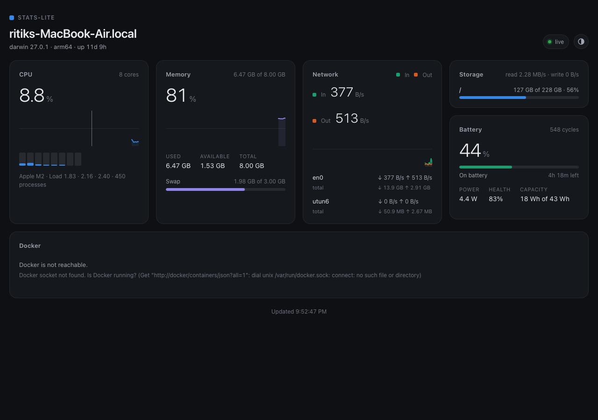

# stats-lite

A tiny, single-binary system monitor with a clean web UI. Think `btop`, but a
page you open from any device on your network. Built for home servers where
heavier dashboards feel like overkill.



- **CPU** total and per-core usage, load average, process count
- **Memory** used / available / total, swap
- **Network** live in / out throughput per interface
- **Storage** usage per filesystem, disk read / write throughput
- **Battery** charge, time remaining, power draw, health and cycle count on laptops (card hides itself on machines without one)
- **Docker** per-container CPU, memory, network and disk I/O
- Live updates every second over Server-Sent Events, two minutes of history
- Light and dark themes, works on a phone
- One static binary, about 11 MB, no runtime, no database, no build step for the UI
- Linux, macOS and Windows (amd64 and arm64)

## Quick start

### Run the binary

Download the build for your platform from the Releases page (or build it, see
below), then:

```sh
./stats-lite
```

Open <http://localhost:8080>. On a home server, open `http://<server-ip>:8080`
from any device on the network.

### Build from source

Requires Go 1.24 or newer.

```sh
git clone <this repository> && cd stats-lite
make build          # ./stats-lite for this machine
make build-all      # dist/ with binaries for Linux, macOS and Windows
```

### Docker

```sh
docker compose up -d
```

Then open `http://<machine-ip>:8089`. To use a different port, change the
left side of the mapping in `docker-compose.yml` (`"9090:8080"` opens it on
9090).

The compose file shares the host PID namespace and mounts `/` read-only at
`/host`, so the container reports the host's real CPU, memory, disks and
processes rather than its own sandbox. Network counters are read from the
host's PID 1, which is why ordinary port mapping is enough and
`network_mode: host` is not needed. It also mounts the Docker socket
read-only for container stats.

Docker Desktop on macOS or Windows runs containers in a Linux VM, so the
"host" the container sees is that VM: CPU, memory and disks will be the VM's,
not your Mac's or PC's. For a real view of a Mac or Windows machine run the
binary directly; use the container on Linux servers.

## Configuration

Every option is a flag and an environment variable. Flags win.

| Flag | Environment variable | Default | Meaning |
|---|---|---|---|
| `-addr` | `STATS_LITE_ADDR` | `:8080` | Listen address |
| `-interval` | `STATS_LITE_INTERVAL` | `1s` | Sampling interval |
| `-auth` | `STATS_LITE_AUTH` | *(off)* | Require a login, as `user:password` |
| `-docker` | `STATS_LITE_DOCKER` | `true` | Enable Docker container stats |
| `-docker-host` | `DOCKER_HOST` | platform default | Docker daemon address (`unix://`, `npipe://` or `tcp://`) |
| `-host-root` | `STATS_LITE_HOST_ROOT` | *(empty)* | Where the host filesystem is mounted when running in a container |
| `-version` | | | Print the version and exit |

Inside a container, gopsutil also honours `HOST_PROC`, `HOST_SYS` and
`HOST_ETC` (see `docker-compose.yml`).

## Endpoints

| Path | What it returns |
|---|---|
| `/` | The web UI |
| `/api/snapshot` | The latest reading as JSON |
| `/api/stream` | Server-Sent Events, one JSON snapshot per sample |
| `/healthz` | `ok` once the first sample exists |
| `/version` | The build version |

The JSON is stable enough to script against; `curl -s localhost:8080/api/snapshot | jq .cpu.total_percent`.

## Running as a service

**Linux (systemd)** – `/etc/systemd/system/stats-lite.service`:

```ini
[Unit]
Description=stats-lite system monitor
After=network.target docker.service

[Service]
ExecStart=/usr/local/bin/stats-lite
Restart=on-failure
# Needed only for Docker stats: a user in the docker group, or root.
User=root

[Install]
WantedBy=multi-user.target
```

Then `systemctl enable --now stats-lite`.

**macOS** – run it from a `launchd` agent, or simply `brew services`-style
with a plist that calls the binary.

**Windows** – run `stats-lite.exe` directly, or register it with
`sc create` or [NSSM](https://nssm.cc). Docker stats use the
`\\.\pipe\docker_engine` named pipe automatically.

## Security

stats-lite exposes read-only information about the machine, including
hostnames, mount points and container names. On a home LAN that is usually
fine; if you expose it beyond that, set `STATS_LITE_AUTH` or put it behind a
reverse proxy that handles TLS and authentication.

The Docker socket grants root-equivalent control to whoever can reach it.
stats-lite only ever issues `GET` requests to it, and the compose file mounts
it read-only, but treat the socket with the respect it deserves.

## Why not something existing?

If you want more than this, these are good and lighter than Homarr:

- **[Beszel](https://github.com/henrygd/beszel)** – hub + agent model, Docker
  stats, alerts, history. The closest thing to stats-lite with a database
  behind it. Pick it if you want multiple servers and alerting.
- **[Dashdot](https://github.com/MauriceNino/dashdot)** – very pretty single
  host dashboard, Linux-focused, runs as a Node container.
- **[Glances](https://nicolargo.github.io/glances/)** – Python, huge feature
  set, web UI included; heavier and busier.
- **[Netdata](https://www.netdata.cloud)** – thousands of metrics per second;
  powerful, not minimal.

stats-lite deliberately stays at "one binary, one page, no history database".

## Development

```sh
go test ./...        # unit tests plus a fake-Docker-daemon integration test
go vet ./...
make run
```

The UI is plain HTML, CSS and JavaScript in `web/`, embedded into the binary
at build time; edit and rebuild.

## Licence

MIT
